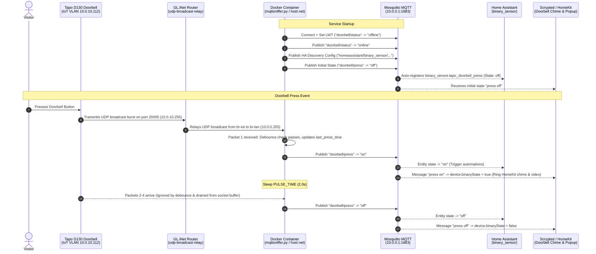

# System Architecture & Code Process Flow

This document details the architectural design, networking mechanics, and execution lifecycle of the **Tapo Doorbell MQTT Sniffer**.

---

## 1. High-Level Overview

TP-Link Tapo smart doorbells (such as the **Tapo D130** wired doorbell and **Tapo D235**) do not expose immediate, local physical button-press events through traditional camera APIs (like ONVIF or RTSP video streams).

However, whenever the physical button is pressed, the doorbell camera transmits an unencrypted **UDP broadcast packet** on destination port **`20005`** across the local network to trigger its indoor wireless chime.

This service intercepts that broadcast in real time, debounces burst packets, and translates the event into standardized **MQTT topics** consumed simultaneously by **Home Assistant** and **Scrypted (Apple HomeKit)** without cloud round-trips.

---

## 2. End-to-End Architectural Diagram



---

## 3. Code Execution & Lifecycle (`mqttsniffer.py`)

### Phase 1: Configuration & Environment Loading
The script loads its settings from environment variables passed via Docker Compose:
* `MQTT_BROKER`: Broker IP/hostname (default: `10.0.0.1`).
* `MQTT_PORT`: Broker port (default: `1883`).
* `MQTT_TOPIC`: Event topic (default: `doorbell/press`).
* `AVAILABILITY_TOPIC`: Service status topic (default: `doorbell/status`).
* `DOORBELL_IP`: Target IP address, or `auto` to accept packets from any sender/relay on port 20005.
* `UDP_PORT`: Port to bind to (`20005`).
* `PULSE_TIME`: Duration in seconds to hold the `"on"` state before resetting to `"off"` (default: `2.0s`).
* `COOLDOWN_TIME`: Cooldown period in seconds to suppress duplicate packet bursts from a single press (default: `5.0s`).
* `HA_DISCOVERY`: Enables automatic Home Assistant registration (default: `true`).

---

### Phase 2: Socket Initialization & Host Networking
To intercept local broadcast datagrams:
```python
sock = socket.socket(socket.AF_INET, socket.SOCK_DGRAM)
sock.setsockopt(socket.SOL_SOCKET, socket.SO_BROADCAST, 1)
sock.setsockopt(socket.SOL_SOCKET, socket.SO_REUSEADDR, 1)
sock.setsockopt(socket.SOL_SOCKET, socket.SO_REUSEPORT, 1)
sock.bind(("", UDP_PORT))
```
* **`SO_BROADCAST`**: Allows the socket to listen for and receive broadcast frames addressed to `255.255.255.255`.
* **`SO_REUSEADDR` & `SO_REUSEPORT`**: Enables instant socket re-binding upon container restarts, avoiding `Address already in use` errors.
* **`network_mode: host`**: Crucial in Docker Compose. Docker bridge networks cannot receive physical broadcast packets; host networking shares the host interface namespace directly.

---

### Phase 3: MQTT Connection, LWT, and HA Discovery
1. **Last Will and Testament (LWT):**
   ```python
   client.will_set(AVAILABILITY_TOPIC, payload="offline", qos=1, retain=True)
   ```
   If the container stops or unexpectedly loses connectivity, the broker automatically publishes `offline` to `doorbell/status`, marking the sensor unavailable in Home Assistant.

2. **On Connect Callback:**
   * Publishes `"online"` to `doorbell/status` with `retain=True`.
   * Publishes Home Assistant MQTT discovery JSON to:
     `homeassistant/binary_sensor/tapo_doorbell/press/config`
     * Uses `"icon": "mdi:bell"` (Home Assistant binary sensors do not support a `doorbell` device class; omitting device class prevents schema rejection).
     * Binds to `availability_topic: "doorbell/status"`.
   * Publishes initial `"off"` state with `retain=True` so Home Assistant never defaults to an `unknown` state.

---

### Phase 4: Event Sniffing, Debouncing, and Buffer Draining

The core loop listens for UDP packets:

```python
last_press_time = 0.0

while True:
    data, addr = sock.recvfrom(1024)
    sender_ip = addr[0]

    is_match = not allowed_ips or sender_ip in allowed_ips

    if is_match:
        now = time.time()
        if now - last_press_time < COOLDOWN_TIME:
            # Drop redundant duplicate packets sent during the same physical press
            continue

        last_press_time = now
        print(f"[UDP] Packet from {addr[0]}:{addr[1]} ({len(data)} bytes) – Doorbell pressed!")
        
        # 1. Trigger ON state
        client.publish(MQTT_TOPIC, payload="on", qos=1, retain=False)
        time.sleep(PULSE_TIME)
        
        # 2. Reset to OFF state
        client.publish(MQTT_TOPIC, payload="off", qos=1, retain=True)

        # 3. Drain OS kernel socket buffer
        sock.setblocking(False)
        try:
            while True:
                sock.recvfrom(1024)
        except (BlockingIOError, socket.error):
            pass
        finally:
            sock.setblocking(True)
```

#### Why Debouncing and Buffer Draining are Critical:
* **The Problem:** Tapo doorbells transmit a rapid burst of 3 to 6 identical UDP datagrams within ~20 milliseconds to prevent packet loss over Wi-Fi.
* **The Trap:** While the script is executing `time.sleep(PULSE_TIME)` (2 seconds), the Linux kernel queues the remaining burst packets in the socket receive buffer. When sleep finishes, `sock.recvfrom` reads the queued packets sequentially, triggering multiple duplicate rings.
* **The Solution:**
  1. `COOLDOWN_TIME` (5s) ignores any packet arriving immediately after a valid press.
  2. `sock.setblocking(False)` flushes all queued datagrams out of the socket buffer in microseconds, ensuring only a single press event is published per physical ring.

---

## 4. Cross-VLAN Relay Mechanics

* **The Challenge:** The doorbell resides on an isolated IoT subnet (`10.0.10.x`), while the server and broker reside on the main LAN (`10.0.0.x`). Standard routers drop Layer 2 broadcast packets at subnet boundaries.
* **The Solution:** The router runs `udp-broadcast-relay-redux`. It listens for UDP broadcasts arriving on `br-iot` (destination port `20005`), re-encapsulates them, and re-broadcasts them onto `br-lan` (`10.0.0.255:20005`), allowing the Debian Docker container to capture the event seamlessly.
